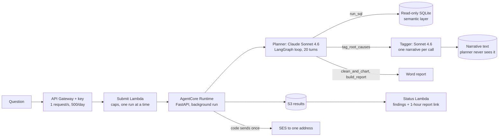

# Complaint Root-Cause Agent

[](https://github.com/PritRai75/complaint-root-cause-agent/actions/workflows/tests.yml)

Ask a plain-English question about CFPB credit card and checking account complaints. An agent queries the data, reads a sample of the complaint narratives to tag each with a root cause, and emails you a Word report with counts, charts and quoted examples.

## Why

Most of the CFPB complaint table is structured, so SQL alone answers "how many" and "how fast". It cannot answer "why", because the reason a consumer is unhappy is in their own words, and the CFPB's `issue` column is a poor stand-in for it (see Results). This project puts a model on the part SQL can't do, and keeps it away from the part where a wrong number would go unnoticed: every figure in a report must come from a query or tag result of the same run, and code refuses anything else.

Scope: Credit card and Checking or savings account complaints received 1 January to 31 August 2026. 125,220 complaints, 41,770 with a narrative. Data is the CFPB's own narratives archive, pinned by hash in `data/manifest.json`.

## Results

All figures are counts with Wilson 95% intervals. Held-out test sets were run once. Details, per-code tables and the misses are in [docs/evaluation.md](docs/evaluation.md).

| What | Result |
| --- | --- |
| Agent, 15 held-out tasks (12 reports, 3 should-ask-first) | **14 of 15** (70.2 to 98.8%) |
| Tagger vs my hand labels, 200 held-out narratives | **163 of 200** exact (81.5%, 75.5 to 86.3%) |
| Tagger per code, same 200 (macro-F1 over all 10 codes) | 71.0%; fraud_claim recall **55 of 55**, precision 55 of 62 (table below) |
| Same labels, re-labelled blind after a gap, 30 items | 27 of 30 (90.0%, 74.4 to 96.5%), kappa 0.88; an upper bound |
| Prompt injection planted in 96 narratives | 6 of 96 tags flipped (2.9 to 13.0%); **0 of 74** became the attack's target (upper bound 4.9%) |
| CFPB `issue` column as a stand-in for root cause | Best lookup, fitted on the same 200: 101 of 200, against the tagger's 163 |
| A root-cause report (200 narratives tagged) | about $3.50 for the tagging and 5 minutes |

Per-code precision and recall of the tagger on the 200 test narratives, re-scored from the same log on 23 November (no tag changed; Wilson 95% intervals where the count is 10 or more). The confusion matrix is in [docs/evaluation.md](docs/evaluation.md#2-the-tagger-163-of-200).

| Code | Labelled | Precision | Recall |
| --- | ---: | --- | --- |
| fraud_claim | 55 | 55 of 62, 88.7% (78.5 to 94.4) | 55 of 55, 100% (93.5 to 100) |
| account_restricted | 30 | 29 of 38, 76.3% (60.8 to 87.0) | 29 of 30, 96.7% (83.3 to 99.4) |
| servicing_error | 29 | 17 of 19, 89.5% (68.6 to 97.1) | 17 of 29, 58.6% (40.7 to 74.5) |
| dispute_mishandled | 27 | 25 of 29, 86.2% (69.4 to 94.5) | 25 of 27, 92.6% (76.6 to 97.9) |
| fee_charged | 14 | 10 of 13, 76.9% (49.7 to 91.8) | 10 of 14, 71.4% (45.4 to 88.3) |
| terms_not_honored | 12 | 11 of 19, 57.9% (36.3 to 76.9) | 11 of 12, 91.7% (64.6 to 98.5) |
| credit_reporting | 10 | 8 of 10, 80.0% (49.0 to 94.3) | 8 of 10, 80.0% (49.0 to 94.3) |
| third_party | 10 | 1 of 1 | 1 of 10, 10.0% (1.8 to 40.4) |
| unclear | 7 | 4 of 4 | 4 of 7 |
| other | 6 | 3 of 5 | 3 of 6 |

What fails, in short: the tagger rarely recognises a complaint that blames only a third party (1 of 10), so those are counted as company causes; it under-counts servicing errors (10.0% tagged against 16.4% labelled on the test set); the agent built a report where it should have asked a question (task A02); and a finding can state a number against the wrong period. The full list is under Limitations.

## Example

A question sent to the deployed API on 16 November 2026, and what the status endpoint returned (a real run: 303 seconds, one email sent, nothing edited). The report is [docs/example/complaint-report-20261116T080938Z.docx](docs/example/complaint-report-20261116T080938Z.docx).

**Question:** What are the most common root causes in credit card complaints about fees or interest from January to June 2026?

```json
{
 "run_id": "run-65c895b998434af7b78dcde4ddb748ea",
 "status": "sent",
 "finished_at": "2026-11-16T08:09:39Z",
 "seconds": 303.1,
 "has_report": true,
 "question": "What are the most common root causes in credit card complaints about fees or interest from January to June 2026?",
 "clarifying_question": null,
 "final_text": "The report is ready — it covers the top root causes across 4,944 fee- and interest-related credit card complaints from January to June 2026, based on a tagged sample of 200 narratives.",
 "stop_reason": null,
 "counts": {
  "turns": 4,
  "tool_calls": 4,
  "tag_runs": 1,
  "failed_calls": 0,
  "nudges": 0
 },
 "sent": {
  "sender": "ses",
  "message_id": "010901a1e3679844-8c234f2b-d8ee-4316-a8c8-5b023a6f53bc-000000"
 },
 "report": {
  "title": "Root Causes in Credit Card Complaints About Fees or Interest, Jan–Jun 2026",
  "findings": [
   "There were 4,944 credit card complaints mentioning fees or interest with a published narrative from January to June 2026, from which 200 were randomly sampled and tagged.",
   "The two leading root causes together account for over half of tagged narratives: 'Offer or terms not honored' (28.2%) and 'Fee or interest charged or not waived' (26.2%) of tagged narratives.",
   "Account servicing errors were the third most common root cause, cited in 15.4% of tagged narratives, followed by fraud or scam claims mishandled at 11.8%.",
   "Transaction disputes mishandled (8.2%) and accounts closed, frozen, or restricted (7.2%) were also notable root causes among tagged narratives.",
   "Credit reporting issues accounted for 3.1% of tagged narratives, the least common identified root cause in this group."
  ],
  "filename": "complaint-report-20261116T080938Z.docx",
  "bytes": 97164,
  "sha256": "7c726a9a90170456be7bdc007bc86cd588616f96c2c4894e56f756c746ce40cd"
 },
 "report_url_expires_in": 3600
}
```

Read it with care, because it shows the limits as well as the result. The top cause, unmet terms, is the one the tagger over-counts (10.0% tagged against 6.8% labelled on the test set), and the top two causes differ by 4 of 195 narratives. The report's first two example quotes are near-identical "never activated, charged a fee" stories, one filed under unmet terms and one under fees: the boundary between those two causes, visible in a real report. The population is wider than complaints about fees, and the report's method section doesn't print the query that defined it. More in [docs/evaluation.md](docs/evaluation.md#4-the-deployed-run-used-as-the-readme-example).

## Quick start

Needs Python 3.13. The tests need no AWS credentials and no data; 8 tests that read the real database skip.

```
git clone https://github.com/PritRai75/complaint-root-cause-agent.git
cd complaint-root-cause-agent
python -m venv .venv
. .venv/Scripts/activate        # Git Bash on Windows; on Linux or macOS: . .venv/bin/activate
pip install -r requirements.txt -r requirements-dev.txt
python -m pytest -q
```

To run the agent yourself you need the data and an AWS account with Bedrock access to Claude Sonnet 4.6 (the planner and the tagger):

```
python -m ingest.fetch
python -m ingest.build_db
python -m agent.semantic build
python -m agent.graph "What were the three most common root causes in credit card complaints received from January to June 2026, and what share of the tagged narratives did each one account for?"
```

The first three steps download the seven archive zips, check them against the manifest and build the two SQLite files. The last one runs the agent with a dry-run sender and saves the report under `scratch/`. `python -m agent.graph --ses "question"` sends it through SES instead. Deploying the API is `sam deploy` with the steps at the top of `template.yaml`; it needs a verified SES address, and its live copy is private (one API key, one recipient).

## How it works



- **A semantic layer, not raw tables.** The agent's database is built from three views (complaints Jan to Aug, final responses Jan to Jun, narratives Jan to Jul), so rows outside a window are not in it and no SQL can reach them. Timely response and relief rates use the Jan to Jun complaints only, since later responses aren't final.
- **The planner never reads consumer text.** It filters with `text_has(id, 'phrase')` and asks for tagging as a tool that returns counts. Quotes in the report are inserted by code. This is why an instruction planted in a narrative can only reach the tagger, whose answer is one code from a fixed list.
- **Numbers are checked by code.** `build_report` refuses a finding containing a number that isn't in the run's own query or tag results (rounding allowed), refuses legal conclusions, and ignores numbers the model typed into SQL (checked against two database samples).
- **Guaranteed by code or IAM:** one fixed recipient (enforced in the code and in the SES policy), one send per run, a read-only database that refuses `ATTACH`, `PRAGMA` and writes, and limits of 20 turns, 30 tool calls, 2 tagging runs and a stop after 4 failed calls in a row.
- **Only measured, not guaranteed:** tagging accuracy, injection resistance, and whether a finding's wording matches its numbers.
- **CI.** GitHub Actions runs the test suite on every push and pull request, with no AWS credentials (the 8 tests that need the real database skip there). `main` accepts changes only through a pull request whose tests pass. [PR #1](https://github.com/PritRai75/complaint-root-cause-agent/pull/1) removes one word pattern from the legal-wording check on purpose: the build failed, and the PR was closed unmerged.

## Limitations

- The taxonomy has 7 root causes plus `third_party`, `other` and `unclear`. Some real complaints don't fit (privacy, opt-outs, deposit pull-backs); there is no v2.
- Tag shares are biased: servicing errors are under-counted by about 6 points, account restrictions and unmet terms over-counted by about 3 each. One 200-item sample, so a direction rather than a correction.
- Narratives that blame only a third party are rarely recognised (1 of 10).
- The number check misses direction ("rose" for a fall), a real number attached to the wrong period or category, and number words ("five of the eight months"). It was found wrong this way in the deployed run 2.
- The report's method section lists chart queries only, not every query a finding uses, and not the query that defined a tagged population.
- A fee-related population built with `text_has('interest')` also catches passing mentions.
- Clarifying questions are cut at 300 characters, in one run mid-sentence, and one offered "cities", which the data doesn't have.
- Narrative coverage dips and is not explained: narratives on credit-reporting complaints fall to 0.1% after August 2025, and card and checking coverage drops to 28.4% in February 2026.
- Task A02 ("Which bank has been the worst for credit card customers this year?") should have asked which measure was meant. Both runs built a report on volume, relief rate and timely rate instead. One named Capital One "the broadest concern" without noting that raw complaint counts rise with a bank's size, which this data can't adjust for.
- Quotes keep the bank names and the consumer's own legal claims, as published, with a note. A planted attack was quoted once.

## License

The code is under the MIT License (see [LICENSE](LICENSE)). The complaint data is published by the CFPB and isn't stored in this repository; `python -m ingest.fetch` downloads it from the source recorded in `data/manifest.json`.
