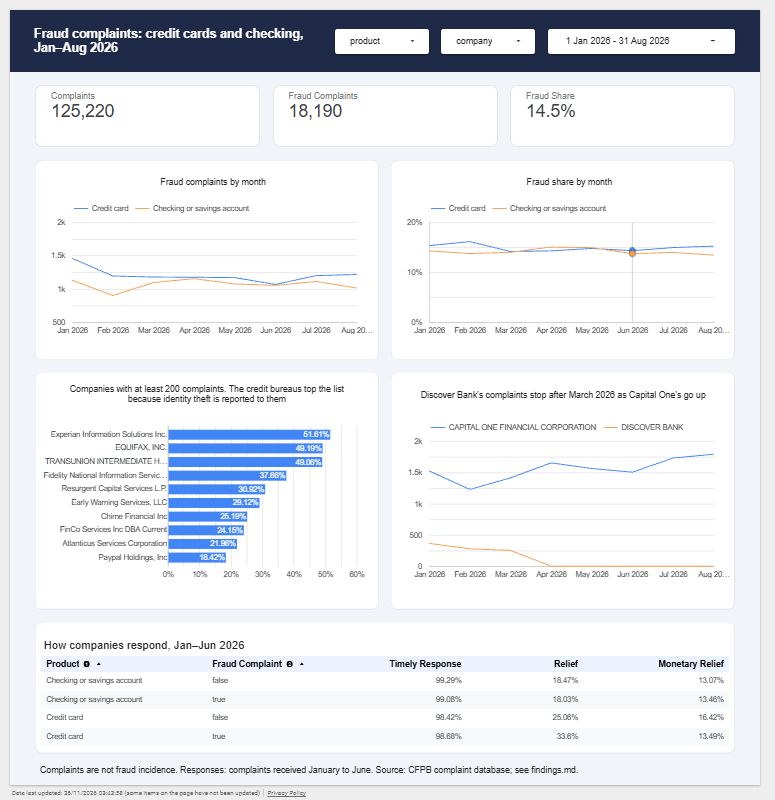

# Fraud complaint dashboard (Looker Studio)

**Link (view only):** https://datastudio.google.com/reporting/c32d379f-a561-48ed-9675-499d8d86a38d

One page over the BigQuery sandbox dataset `complaints_analytics`. The numbers it shows are the same as `findings.md`, because it reads the same view and queries.

## Data sources

| Name in Looker Studio | BigQuery source | Feeds |
| --- | --- | --- |
| Flagged complaints | view `complaints_analytics.complaints_flagged` | scorecards, monthly charts, filters |
| Company rates | custom query: contents of `sql/02_company_rates.sql` | top-10 bar chart |
| Responses | custom query: contents of `sql/05_response.sql` | fraud vs other table |
| Discover follow-up | custom query: contents of `sql/06_discover_followup.sql` | Capital One and Discover line chart |

Custom queries are pasted without the final semicolon, for example `sed 's/;[[:space:]]*$//' analytics/sql/02_company_rates.sql | clip`.

Calculated fields on **Flagged complaints**:

| Field | Formula |
| --- | --- |
| Fraud complaints | `SUM(CASE WHEN is_fraud THEN 1 ELSE 0 END)` |
| Fraud share | `SUM(CASE WHEN is_fraud THEN 1 ELSE 0 END) / COUNT(complaint_id)` (format: percent) |

## Layout

Canvas 1200 × 1500.

| Position | Chart | Setup |
| --- | --- | --- |
| Header | Title and 3 filter controls | title "Fraud complaints: credit cards and checking, Jan–Aug 2026"; drop-downs on `product` and `company`; date range on `date_received` |
| Top row | 3 scorecards | Record Count renamed "Complaints"; Fraud complaints; Fraud share |
| Second row, left | Time series "Fraud complaints by month" | dimension `month`, metric Fraud complaints, breakdown `product` |
| Second row, right | Time series "Fraud share by month" | dimension `month`, metric Fraud share, breakdown `product`; left Y-axis 0 to 20% |
| Third row, left | Bar chart (Company rates) | dimension `company`, metric `fraud_rate` (percent), sorted descending, 10 bars, Group Others off, no legend |
| Third row, right | Time series (Discover follow-up) | dimension `month` as Year Month, metric `complaints`, breakdown `company`, both products (no product filter, so the totals match the Q6 table in `findings.md`); missing data shown as zero |
| Bottom | Table "How companies respond, Jan–Jun 2026" (Responses) | columns Product, Fraud complaint, Timely response, Relief, Monetary relief (`product`, `is_fraud`, `timely_rate`, `relief_rate`, `monetary_relief_rate`, percent); sorted by product, then `is_fraud`; no row numbers or pagination |

Text boxes:

- Above the company bar chart: "Companies with at least 200 complaints. The credit bureaus top the list because identity theft is reported to them."
- Above the Discover chart: "Discover Bank's complaints stop after March 2026 as Capital One's go up"
- Footer: "Complaints are not fraud incidence. Responses: complaints received January to June. Source: CFPB complaint database; see findings.md."

Settings that are not the defaults:

- **Complaints scorecard:** Record Count, because `complaint_id` is an INTEGER and Looker Studio would sum it.
- **Default date range:** Custom, 1 January to 31 August 2026, on the date range control and on the Discover chart. The default "Auto" shows the last 28 days, which have no data.
- **Filter controls:** grouped with the scorecards and the two monthly charts. A control filters every chart whose data source has a field with the same name, and `company` and `product` are also in the custom queries; grouping keeps the three custom-query charts showing their whole query.

## Sharing

**Share** → anyone on the internet with the link can **view**. The four data sources use the owner's credentials (the default), so viewers don't need BigQuery access.

In the sandbox, tables and views expire 60 days after they are created. Before showing the dashboard after that, rebuild the CSV with `python -m analytics.export table`, upload it again as `complaints`, upload `fraud_mapping.csv` again, and run `sql/00_flagged_view.sql` again. The dashboard then works as before.
