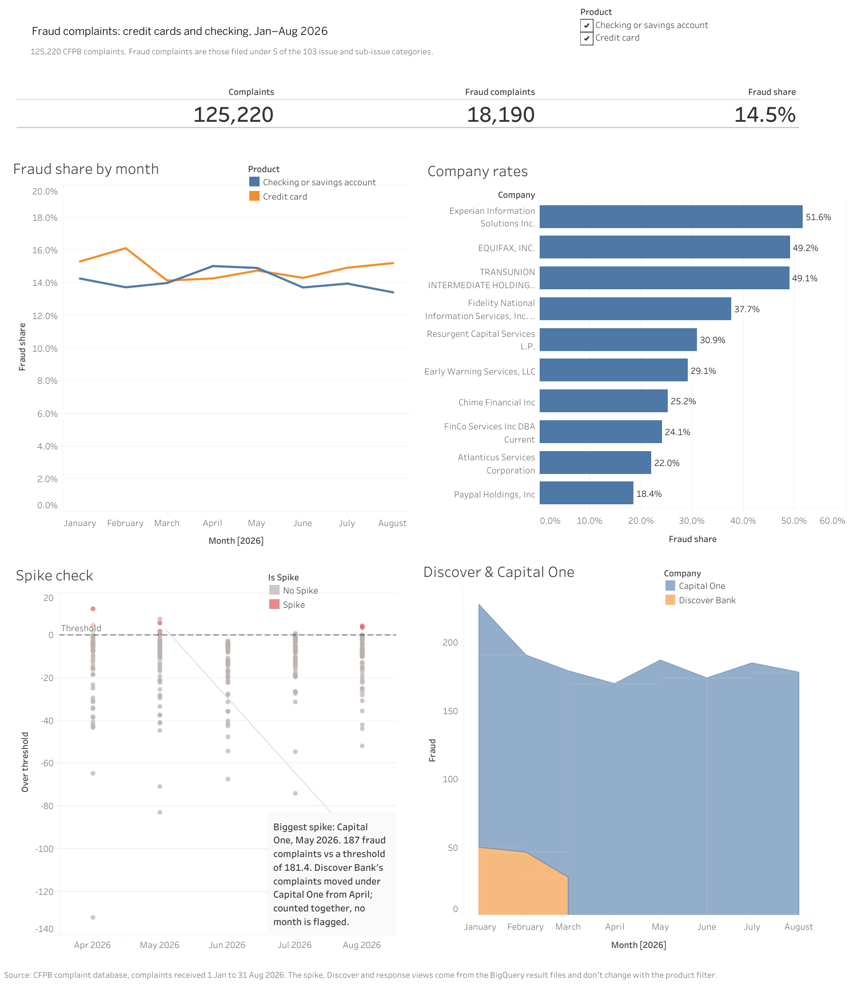

# Fraud complaints in Tableau

The BigQuery fraud investigation in [analytics/](../analytics/), rebuilt as a Tableau Public dashboard and story. Tableau computes the headline figures itself from the row-level complaints, and every figure was checked against the BigQuery result files before publishing.

- Dashboard: [Fraud complaints: credit cards and checking, Jan–Aug 2026](https://public.tableau.com/app/profile/prit.raithatha/viz/fraud-complaints/Dashboard1)
- Story: [the same findings in five steps](https://public.tableau.com/app/profile/prit.raithatha/viz/fraud-complaints/Story1)



The dashboard is a static publish of the data as of the BigQuery load. It changes only when the workbook is republished.

## Data

| Source | Rows | Used for |
| --- | --- | --- |
| `build/analytics/complaints.csv`, the file loaded into BigQuery, written by `python -m analytics.export table` (no narrative text) | 125,220 | KPI tiles, monthly fraud share, company rates |
| `analytics/fraud_mapping.csv` | 103 | The fraud flag |
| `analytics/results/q3_spikes.csv` | 265 | Spike check |
| `analytics/results/q6_discover_followup.csv` | one row per company, product and month | Discover Bank and Capital One |
| `analytics/results/q4_response.csv` | one row per product and fraud flag | Responses, in the story |

The complaints and the mapping are joined (inner join) on product, issue and sub-issue. A blank sub-issue is empty in both files, so the sub-issue clause is a join calculation on both sides, `IFNULL([Sub Issue], "")`, as BigQuery's view does with `IFNULL(sub_issue, '')`. Without it, complaints with no sub-issue would not match their mapping row. The join is a join, not a relationship: with a relationship, a count of a mapping field is taken at the mapping's level (103 rows), not the complaints'.

## Calculated fields

```
Complaints        COUNT([Complaint Id])
Fraud complaints  SUM(IIF([Fraud] = "yes", 1, 0))
Fraud share       [Fraud complaints] / [Complaints]
Month             DATE(DATETRUNC('month', [Date Received]))
Over threshold    [Fraud] - [Threshold]        (q3_spikes source)
```

Company rates keep companies with at least 200 complaints and show the top 10 by fraud share, the same order of filtering as `sql/02_company_rates.sql`.

The product filter applies to every sheet built from the complaints (KPI tiles, monthly fraud share, company rates). The spike check, Discover and response views come from result files and stay fixed; the dashboard footer says so.

## Checked against the BigQuery results

Every figure below was read from Tableau and matched against the result file, before publishing.

| Tableau sheet | Checked against | Result |
| --- | --- | --- |
| KPI tiles: 125,220 complaints, 18,190 fraud complaints, 14.5% | `q0_check.csv`, `derived.csv` | Match |
| Fraud complaints by flag: 18,190 yes, the rest no, adding to 125,220 | `q0_check.csv` | Match |
| Monthly counts and shares, all 16 product-months | `q1_monthly.csv` | All match |
| Company rates: top 10 in order, Experian 51.6% to PayPal 18.4% | `q2_company_rates.csv` | All 10 match |
| Spike check: 265 company-months, 7 flagged, the biggest Capital One in May (187 against a threshold of 181.4) | `q3_spikes.csv`, `derived.csv` | Match |
| Discover Bank and Capital One fraud complaints by month, both products | `q6_discover_followup.csv` | Match |
| Responses, January to June: all 12 rates, for example card fraud relief 33.6% against 25.1% | `q4_response.csv` | All 12 match |
| Product filter: each product's KPI tiles | the 8 months of that product in `q1_monthly.csv`, added up | Match |

Every number in this file must appear in a result file; `tests/test_analytics_findings.py` checks it, as it does for `analytics/findings.md`.

## Rebuilding it

1. Write the complaints file and put the mapping next to it:

```
PYTHONUTF8=1 python -m analytics.export table
cp analytics/fraud_mapping.csv build/analytics/
```

2. In Tableau Desktop Public Edition, connect to `build/analytics/complaints.csv`, open the join view, add `fraud_mapping.csv` with an inner join on the three clauses above, and add the result files as separate data sources.
3. Rebuild the calculated fields and check the KPI tiles first: 18,190 fraud complaints means the join matched every complaint.

## Wording

Fraud complaints are complaints filed under the 5 fraud categories of the mapping; they are not confirmed fraud, and scams can't be separated from other fraud in these categories. The spike check is a rule-based check (trailing 3-month mean plus 2 standard deviations), not anomaly detection, and a flagged company-month is not a fraud wave.
